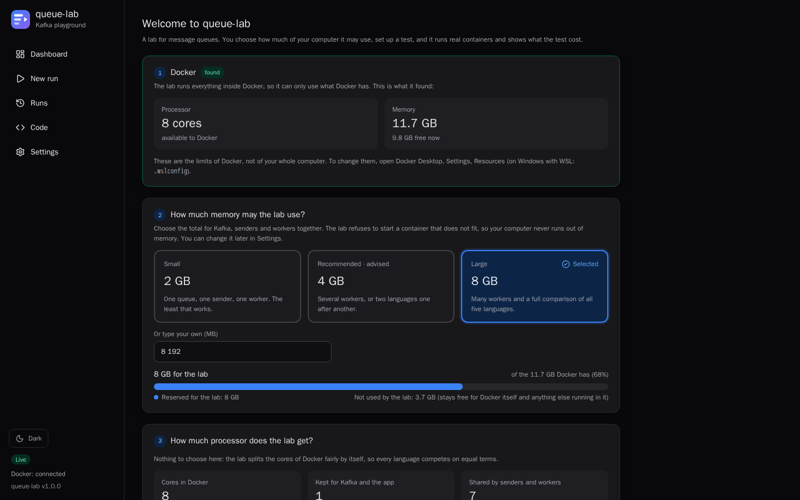
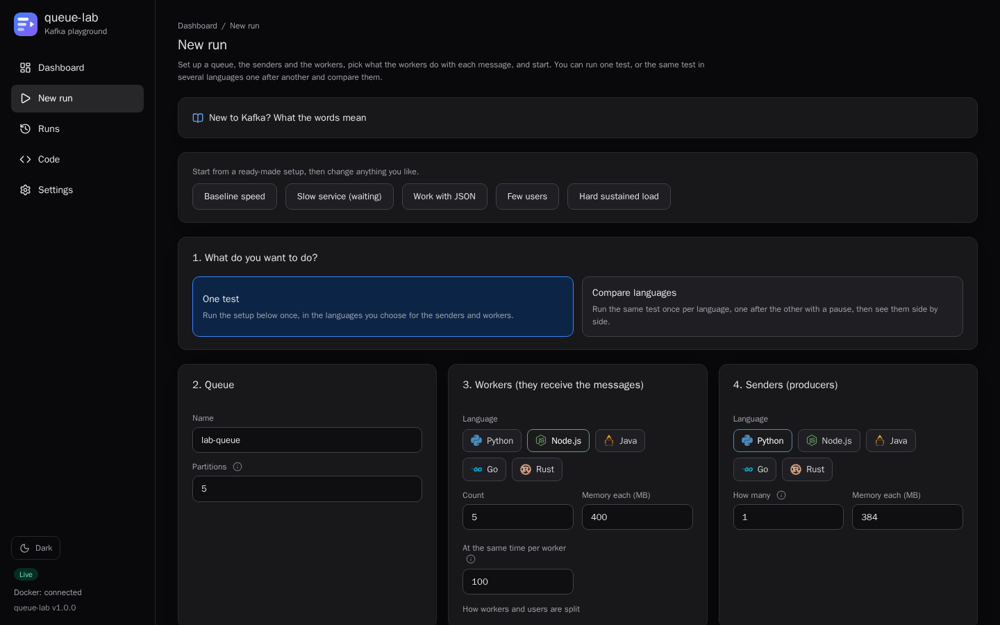
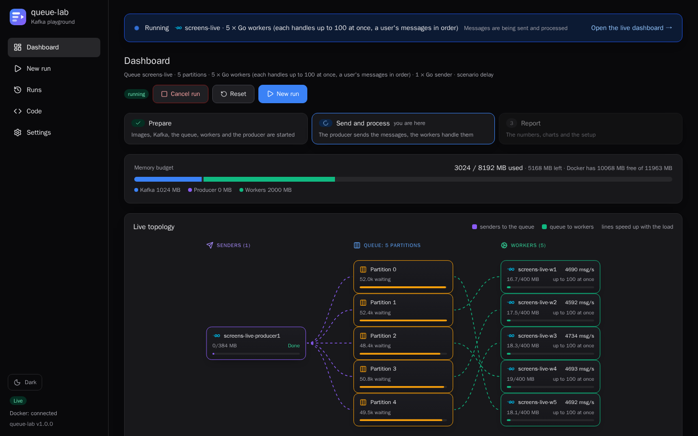
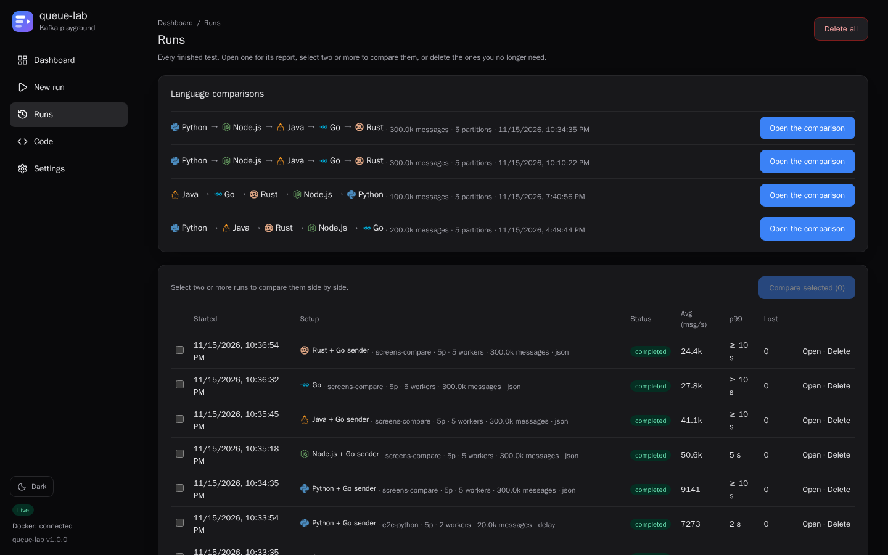
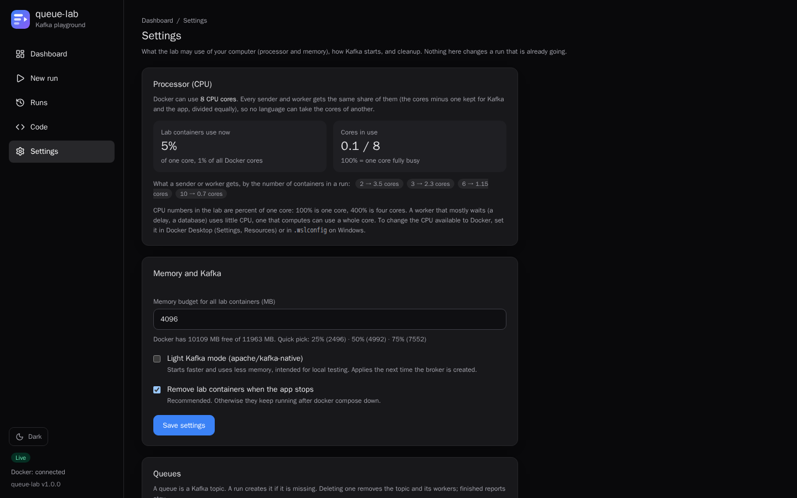
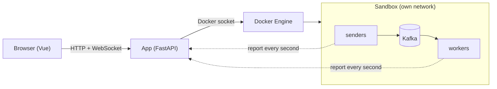
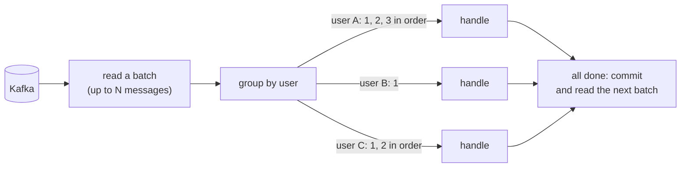
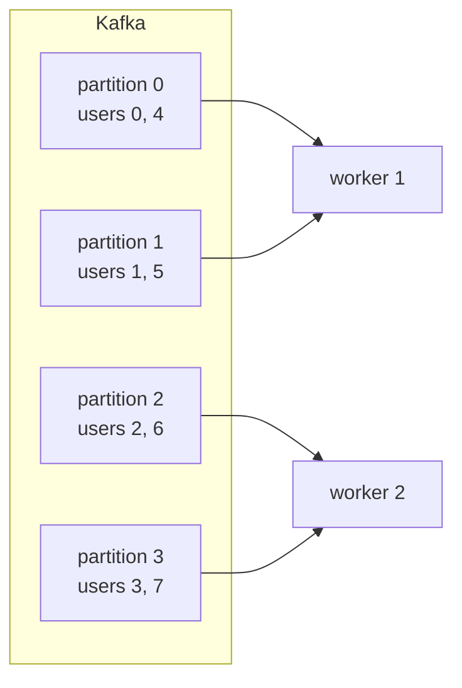
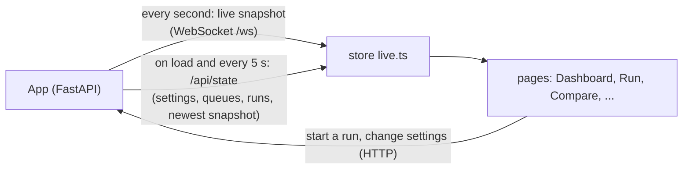

<div align="center">

# 🧪 queue-lab

### An interactive lab for message queues that runs **real containers**

Create a Kafka queue, start senders and workers in 🐍 Python, 🟢 Node.js, ☕ Java, 🐹 Go or 🦀 Rust with memory limits,
send messages and see what it costs on your machine.<br>
Run the same test in every language and compare.

⚡ speed · ⏱️ latency · 📬 messages waiting · 🔥 CPU · 🧠 memory · 🌐 network

[](https://github.com/SiarheiBokuts/queue-lab/actions/workflows/ci.yml)
[](LICENSE)
[](https://www.docker.com/products/docker-desktop/)
[](https://kafka.apache.org/)
[](https://fastapi.tiangolo.com/)
[](https://vuejs.org/)<br>
[](workers/python)
[](workers/node)
[](workers/java)
[](workers/go)
[](workers/rust)

**[🚀 Quick start](#-quick-start)** ·
[🎯 What it checks](#-what-it-measures-and-checks) ·
[✨ Features](#-features) ·
[🖼️ Screens](#️-screens) ·
[⚙️ How it works](#️-how-it-works) ·
[⚖️ Fair comparison](#️-fair-comparison) ·
[🧬 Workers](#-the-five-workers) ·
[⚠️ Known limits](#️-known-limits) ·
[🤝 Contributing](CONTRIBUTING.md) ·
[📝 Changelog](CHANGELOG.md)

<br>


</div>

> [!WARNING]
> **🧪 This is a test version.** The lab is an experiment and a learning project, not a benchmark you should take
> decisions from. The author is not an expert in all five worker languages: the code of a language may not be the most
> idiomatic way to write it, and the numbers depend on your machine, the scenario and the libraries. Somewhere I may
> well have made a mistake, in the code, in how something is measured or in what the screens say 🙂. If you see
> something wrong, or something that a language does better, an issue or a pull request is welcome.

## 🚀 Quick start
> [!NOTE]
> You need [Docker](https://www.docker.com/products/docker-desktop/). The lab needs **1 GB of memory at least**
> (for example 1 Kafka, 1 sender and 1 worker, with *Light Kafka mode* on in Settings). That size was tried in all five
> languages: 100,000 messages, nothing lost. More memory allows more workers: 4 GB is advised, 8 GB fits a comparison of
> all five languages. You choose the size on the first visit and later in Settings; a form that asks for more than that
> only warns, and the app refuses just what does not fit. All the numbers are in `backend/app/config.py`.

```bash
git clone https://github.com/SiarheiBokuts/queue-lab.git
cd queue-lab
docker compose up --build
```

Open <http://localhost:8080>. The first start builds the app, the first run of each language builds its worker image.
Stop with `docker compose down`; the containers the app created are removed with it.

## 🎯 What it measures and checks

| 📏 Measured | ✅ Checked |
|---|---|
| ⚡ **Speed** — messages per second a worker handles under the load you set (count, size, rate, senders, compression) | 🔢 **No lost or duplicated messages** — every message has a number per sender and partition, so lost and repeated ones are counted |
| ⏱️ **Latency** — time from send to handling, taken from the send time in each message header | 🧑‍🤝‍🧑 **Order per user** — a user's messages go to one partition and are handled one after another while other users run in parallel; every worker counts a message handled after a later one of the same user ("Handled out of order", normally 0) |
| 📬 **Backlog** — messages waiting per partition while the test runs | 🧾 **Sent against received** — the report compares what was really sent with what the workers got |
| 🧠 **Resources** — CPU, memory and network of every container, read from Docker the same way for every language | 🛡️ **Memory budget** — the app refuses containers that do not fit in the limits you set |
| 🌍 **Languages** — the same test in Python, Node.js, Java, Go and Rust, in random order, every number side by side | |

**🎭 Scenarios:** echo (count only), delay (waits like a database call), JSON (parses a ~600 byte document and writes it
back with the standard JSON library of the language, the closest to real service work; the libraries differ, Python's is
written in C, Go's and Java's in the language itself).

## ✨ Features
- 🎛️ **Load:** you type any numbers: messages, message size, send speed, senders, workers, partitions, users, compression, compressible or random data. Nothing is capped; when a number looks too big the form says what to expect (for example that the run will not finish in the 30 minutes after which a run is stopped, or that Kafka refuses a message above 1 MB) and you can run it anyway. Only the memory budget can refuse a setup, so your computer does not run out of memory.
- 👷 **Workers:** the batch size, how many messages one worker handles at once; messages of one user are always handled in order.
- 📡 **Live view:** topology, progress, messages waiting per partition, every container.
- 📋 **Report:** message window, resources, latency, network (needed against really sent), with the setup that produced them.
- 🆚 **Compare languages:** the same test per language in random order, with every metric side by side. No grades or winner: the result depends on the scenario and your machine.
- 🌗 **Light and dark theme**, code shown with the colours of VS Code.

The scenarios and the memory budget are described in [What it measures and checks](#-what-it-measures-and-checks).

## 🖼️ Screens
The first visit starts on a page that shows what Docker has and asks how much memory the lab may use.



| New run | Dashboard while a run is going |
|---|---|
|  |  |

| Run report | Code |
|---|---|
|  |  |

| Runs | Settings |
|---|---|
|  |  |

## ⚙️ How it works


The app starts the containers; workers get their settings as environment variables and send a JSON report every
second (`backend/app/contract.py`). Every message has a header (run, sender, partition, sequence number, send time)
and a key (the user). Sequence numbers show lost and duplicated messages, send time gives the latency.

A worker reads a batch, groups it by user, handles the groups at the same time and commits. The same loop is written in
every language with the same steps and names (`read_batch`, `group_by_user`, `run_batch`, `commit`; the code is on the
Code page). The messages of one user are always handled one after another, like payments of one customer in
production; the messages of different users run side by side, up to the batch size you set ("At the same time per
worker").



With several workers Kafka gives every partition to one worker, and a user always lands in one partition, so one user
is never handled by two workers at once.



### 🖥️ How the frontend works
The UI is a Vue 3 single page app (`frontend/src`). One store, `stores/live.ts`, holds everything the pages show.



- **Live snapshot:** the backend builds a snapshot of the lab every second (twice a second during a run): the
  containers with their CPU, memory and network, the memory budget, and the current run with its latest points. It
  pushes it over the WebSocket to every open page. `/api/state` also returns the newest snapshot, so a page that has
  just loaded is complete before the first WebSocket message.
- **Pages** only read the store and call the API (`api.ts`); they never open their own connection.
- **Logs** of a container use a second WebSocket (`/ws/logs/{name}`) that streams the container output.
- **First visit:** the router sends a new user to the welcome page to choose the memory budget (`welcomed` setting).
- **Theme:** dark or light, switched at the bottom of the sidebar (`theme.ts`).

## ⚖️ Fair comparison
Every worker gets the same Kafka settings from `backend/app/config.py`, reads the same environment variables, sends
the same report and does the same steps per message (listed on the Code page), each written the natural way in its
language. Every worker and sender container gets the same share of the cores of your machine (cores minus one kept for Kafka, divided equally) and the same memory limit, and a worker computes as many messages at once as it has whole cores, so a language that uses more threads cannot take the cores of the others. CPU, memory and network are read by the app from Docker for every container the same way (twice a second,
the numbers `docker stats` shows), not by the workers. A comparison runs the languages one after another with a pause.
The lab shows the numbers and the setup behind them; it does not name a winner. How the five workers are built, what
is special in each language and why we think the comparison is fair is in **[docs/workers](docs/workers/README.md)**.

A sender may hold only a limited amount of data that the broker has not confirmed yet, so a slow broker cannot make it
fill its memory. The limit is in `config.py` (300,000 messages or 32 MB, whichever is smaller) and is the same for every
language: Python, Go and Rust hand it to the Kafka client as it is, Java turns the 32 MB into its `buffer.memory`, and
Node.js turns it into the number of batches it may have waiting. It is a memory guard and not a speed setting: at the
default message size it is far above what the connection needs, so a sender stops at it only when the broker is behind.

### 🔢 How lost and repeated messages are counted
Every message has a number per sender and partition. A worker reports the numbers it received as ranges (`0-4999,
5001-9000`): a run without losses is one range per stream. The app merges the ranges of all workers. A number nobody
received is lost; a number received more than once is a repeat, also when it was read again by another worker or after
a restart. A stream with more than 1000 ranges is only counted, and the report says how many numbers were not listed.

### 🧰 Kafka settings
All client settings live in `backend/app/config.py` and go to every worker unchanged (the Java client gets the same
values under its own names, see `KafkaConf.java`): `acks=1`, `linger.ms=5`, batches of up to 10 000 messages,
`fetch.wait.max.ms=50` (also the longest a worker waits for a batch), `fetch.min.bytes=1`, a read-ahead of 10 000
messages or 32 MB per partition, manual commit. The only known gap is Java, which has no read-ahead queue.

## 🧬 The five workers
Every worker does the same steps with the same names; what is different is the standard Kafka client of the language
and the way it handles many messages at once. Start with the **echo** scenario (a message is only counted): it is the
closest to a measure of the client and the language. `delay` and `json` can differ much more between languages, and
`json` also compares the JSON libraries. Details, reasons and open questions per language are in
[docs/workers](docs/workers/README.md).

| | Kafka client | How a batch is handled | Special in this language |
|---|---|---|---|
| 🐍 **[Python](docs/workers/python.md)** | `confluent-kafka` 2.16 (librdkafka) | a thread per user group | `json` work goes to a process pool, because even the C `json` module holds the interpreter lock; Python 3.14 until a wheel for 3.15 exists |
| 🟢 **[Node.js](docs/workers/node.md)** | `@confluentinc/kafka-javascript` 1.11 (librdkafka) | an `async` function per group on the event loop | sends in batches, reads one partition per batch, holds sent data twice; `json` work goes to `worker_threads`; Node.js 24 until a binary for 26 exists |
| ☕ **[Java](docs/workers/java.md)** | Apache `kafka-clients` 4.4 | a virtual thread per group | the only client that is not librdkafka: settings are translated by `KafkaConf.java`, no read-ahead queue, a batch capped at 1 MB like librdkafka |
| 🐹 **[Go](docs/workers/go.md)** | `confluent-kafka-go` 2.16 (librdkafka, cgo) | a goroutine per group | standard `encoding/json`; the image is built with cgo |
| 🦀 **[Rust](docs/workers/rust.md)** | `rdkafka` 0.39 (librdkafka) | a pool of threads that live as long as the worker | its echo speed changes from run to run (from far below Go to equal) for a reason not found yet; see the page |

## ⚠️ Known limits
- **JSON scenario** compares the standard JSON libraries as much as the languages: they are written in different languages and tuned differently.
- **A worker that is killed mid-run** hands its partitions to the others and the run goes on, but the last second it did not report is missing, so the lost number can be too high; the report says so. Duplicates from its unfinished batch only show up if it had reported those messages.
- **Offsets are committed after every batch.** A crash repeats the batch, so messages may arrive twice (counted as duplicates); nothing is lost.
- **The next batch starts when the whole batch is done.** One user with many slow messages makes the others in that batch wait. The report shows the cost as "Waiting for the slowest user" (share of the batch time). Production libraries that avoid this are more complex; the lab keeps the simple rule.
- **One broker, `acks=1`, no TLS:** closer to production in load and batching than in replication.
- **Node.js sends in batches and holds a sent batch in its own buffers until the broker confirms it.** Every language is held to the same limit of unconfirmed data (300,000 messages or 32 MB, `config.py`); the clients of the other languages enforce it themselves, Node.js turns it into the number of batches it may have waiting, and as it holds the data twice (its buffers and the client queue) its sender needs more memory than the others for big messages.
- **Node.js reads a batch of one partition** (the client's own batching); the other languages read from all their partitions. The Java client has no read-ahead queue (`queued.*`).
- **Runtime versions are not all the newest.** The Node.js worker runs on Node.js 24 and the Python worker on Python 3.14, while the frontend build uses Node.js 26 and the backend Python 3.15. The Kafka client libraries have no prebuilt binary for the newer ones yet (`@confluentinc/kafka-javascript` for Node.js 26, `confluent-kafka` for Python 3.15), and building them from source fails. They move up when a release with a binary is out.

## 📁 Project layout
```
backend/    the app (FastAPI): main, runs, analysis, advice (warnings), contract, config, docker_service, kafka_service, store, tests
workers/    one folder per language: python, node, java, go, rust (same steps, same contract, own tests and style checks)
frontend/   the UI (Vue 3, TypeScript): pages, components (setup/ has the sections of the run form), composables, stores
e2e/        end-to-end tests (Playwright) and the script that takes the screenshots
openspec/   specification and design decisions
docs/       screenshots, and workers/: how each worker is built and why the comparison is fair
.github/    CI: tests, image builds, secrets, dependencies, Dockerfiles, workflows
compose.yaml       the lab itself (docker compose up)
compose.e2e.yaml   the end-to-end tests and the screenshots, run against the running lab
```

See [CONTRIBUTING.md](CONTRIBUTING.md) for where to change things and how to add a language.

## ✅ Tests
```bash
docker build --target backend-test .
docker build --target web-test .
docker build -f workers/python/Dockerfile.test workers/python
docker build -f workers/node/Dockerfile.test workers/node
docker build -f workers/go/Dockerfile.test workers/go
docker build -f workers/rust/Dockerfile.test workers/rust
docker build -f workers/java/Dockerfile.test workers/java
```

Every build checks the formatting and style, looks for suspicious code, checks the types where the language has them
and runs the unit tests, each with the usual tool of that language (ruff, Biome, gofmt, rustfmt and clippy,
google-java-format, pytest, vitest, ...). The table of what each tool does is in [CONTRIBUTING.md](CONTRIBUTING.md).
CI also builds every image, looks for leaked secrets (gitleaks) and for known vulnerabilities in the dependencies
(npm audit, pip-audit), and checks the Dockerfiles (hadolint) and the workflow files (actionlint).

**End-to-end tests (Playwright)** open the real app in a browser: every page, the run form, the security checks and, in
the slow set, a real run in two languages. Start the lab first (`docker compose up --build`), then:

```bash
docker compose -f compose.e2e.yaml run --rm e2e                      # fast tests: pages, form, security
docker compose -f compose.e2e.yaml run --rm e2e npm run test:slow    # a real run in Go and Python (a few minutes)
docker compose -f compose.e2e.yaml run --rm e2e npm run screenshots  # new screenshots into docs/screenshots
```

The browser runs in a container, so nothing is installed on your machine. More in [CONTRIBUTING.md](CONTRIBUTING.md).

## 🔧 Settings and cleanup
`QUEUELAB_PORT` (default `8080`) sets the port on `127.0.0.1`. The memory budget is chosen on the first visit (by default half of the memory Docker has free) and changed on the Settings page. If the
app was killed and containers remain: `docker compose run --rm app python -m app.cleanup`.

## 🔒 Security
The app mounts the Docker socket, which is root on the host. It listens on `127.0.0.1` only, has no login, and checks
the Host and Origin of requests (also on WebSockets), sends security headers, accepts worker reports of at most 1 MB,
and only streams logs of the lab's own containers. CI scans for secrets and vulnerable dependencies. Do not expose it
to a network. See [SECURITY.md](SECURITY.md).

## 📄 License
MIT