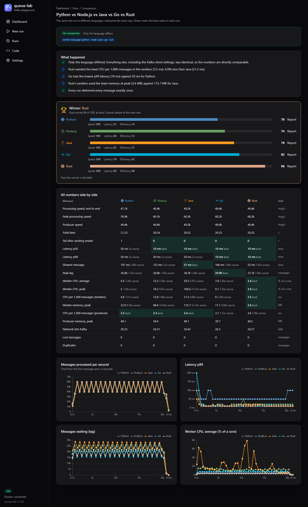
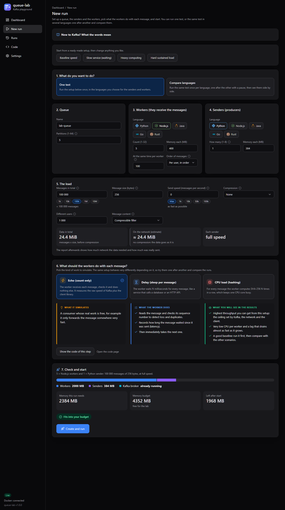
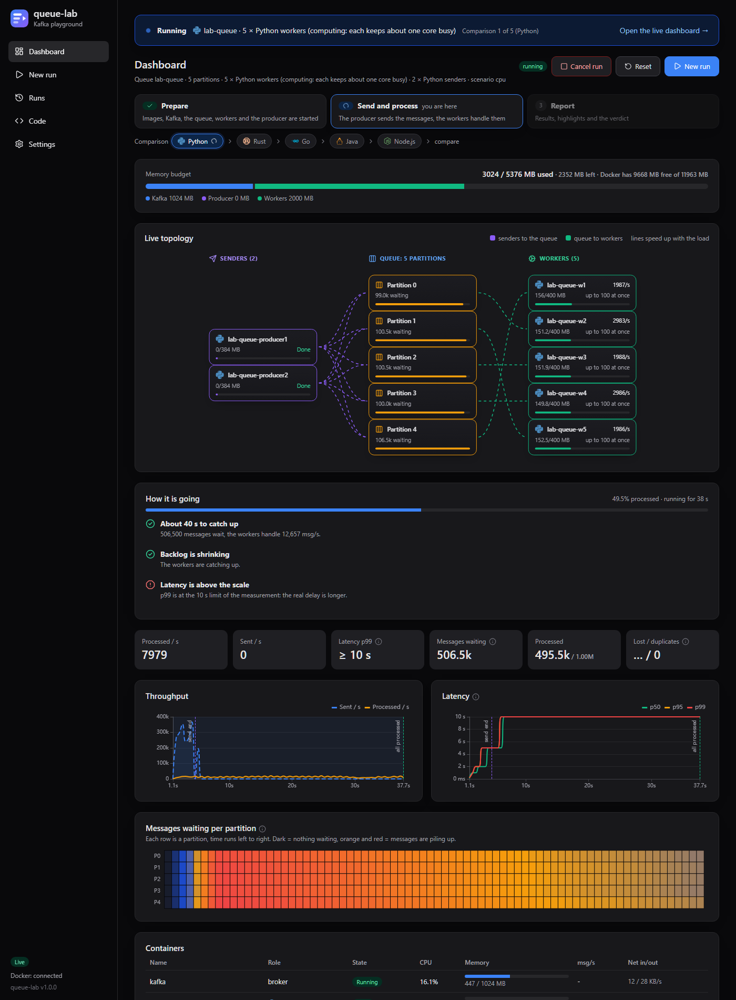
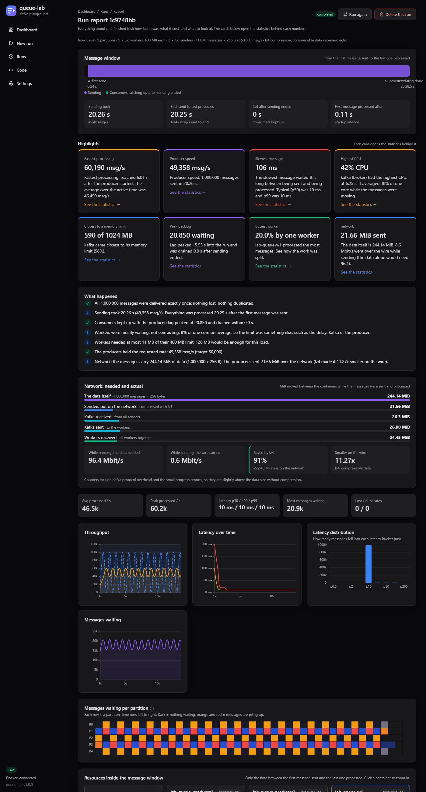
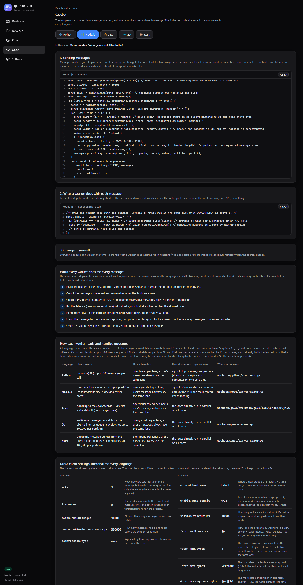
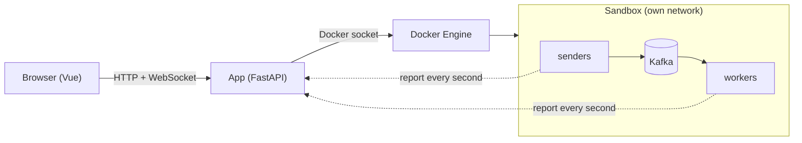
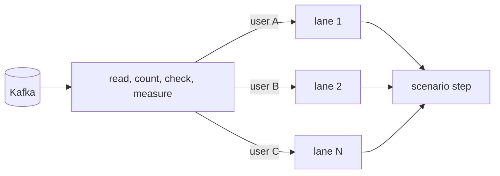

# 🧪 queue-lab
An interactive lab for message queues that runs real containers. Create a Kafka queue, start senders and workers in
Python, Node.js, Java, Go or Rust with memory limits, send messages and see what it costs on your machine: speed,
latency, messages waiting, CPU, memory and network. Run the same test in every language and compare.



**Stack:** Python (FastAPI) · Vue 3 + TypeScript · Kafka · Docker · Go · Rust · Java · Node.js

### 📑 Contents

- [🚀 Quick start](#-quick-start)
- [✨ Features](#-features)
- [⚙️ How it works](#️-how-it-works)
- [⚖️ Fair comparison](#️-fair-comparison)
- [📁 Project layout](#-project-layout)
- [✅ Tests](#-tests)
- [🔧 Settings and cleanup](#-settings-and-cleanup)
- [🔒 Security](#-security)


## 🚀 Quick start
You need [Docker](https://www.docker.com/products/docker-desktop/) (8 GB of memory for it is comfortable).

```bash
git clone https://github.com/SiarheiBokuts/queue-lab.git
cd queue-lab
docker compose up --build
```

Open <http://localhost:8080>. The first start builds the app, the first run of each language builds its worker image.
Stop with `docker compose down`; the containers the app created are removed with it.

## ✨ Features
- **Load:** up to 50 million messages, message size, target rate, several senders, compression, compressible or random data.
- **Workers:** how many messages one worker handles at once, and whether messages of one user stay in order.
- **Scenarios:** echo (count only), delay (waits like a database call), CPU (hashing).
- **Live view:** topology, progress, messages waiting per partition, every container.
- **Report:** message window, verdict, resources, latency, network (needed against really sent).
- **Compare languages:** the same test per language in random order, with a scored winner and every metric side by side.
- **Memory budget:** the app refuses containers that do not fit.

| New run | Dashboard |
|---|---|
|  |  |

| Report | Code |
|---|---|
|  |  |

## ⚙️ How it works


The app starts the containers; workers get their settings as environment variables and send a JSON report every
second (`backend/app/contract.py`). Every message has a header (run, sender, partition, sequence number, send time)
and a key (the user). Sequence numbers show lost and duplicated messages, send time gives the latency.

A worker reads in one loop and hands each message to a lane; messages of one user always use the same lane, so they
stay in order while other lanes work in parallel.



## ⚖️ Fair comparison
Every worker gets the same Kafka settings from `backend/app/config.py`, reads the same environment variables, sends
the same report and does the same steps per message (listed on the Code page), each written the natural way in its
language. CPU, memory and network are read by the app from Docker for every container the same way (twice a second,
the numbers `docker stats` shows), not by the workers. A comparison runs the languages one after another with a pause.
The winner is decided by speed 40 %, latency 30 %, efficiency 30 %, and a run that lost messages cannot win.

## 📁 Project layout
```
backend/    the app (FastAPI): main, runs, analysis, contract, config, docker_service, kafka_service, store, tests
workers/    one folder per language: python, node, java, go, rust (same files, same contract)
frontend/   the UI (Vue 3, TypeScript): pages, components, stores
openspec/   specification and design decisions
docs/       screenshots
```

See [CONTRIBUTING.md](CONTRIBUTING.md) for where to change things and how to add a language.

## ✅ Tests
```bash
docker build --target backend-test .
docker build --target web-test .
docker build -f workers/python/Dockerfile.test workers/python
docker build -f workers/node/Dockerfile.test workers/node
docker build -f workers/go/Dockerfile.test workers/go
docker build -f workers/rust/Dockerfile.test workers/rust
docker build -f workers/java/Dockerfile.test workers/java
```

## 🔧 Settings and cleanup
`QUEUELAB_PORT` (default `8080`) sets the port on `127.0.0.1`. The memory budget is set on the Settings page. If the
app was killed and containers remain: `docker compose run --rm app python -m app.cleanup`.

## 🔒 Security
The app mounts the Docker socket, which is root on the host. It listens on `127.0.0.1` only, has no login, and checks
the Host and Origin of requests. Do not expose it to a network. See [SECURITY.md](SECURITY.md).

## 📄 License
MIT